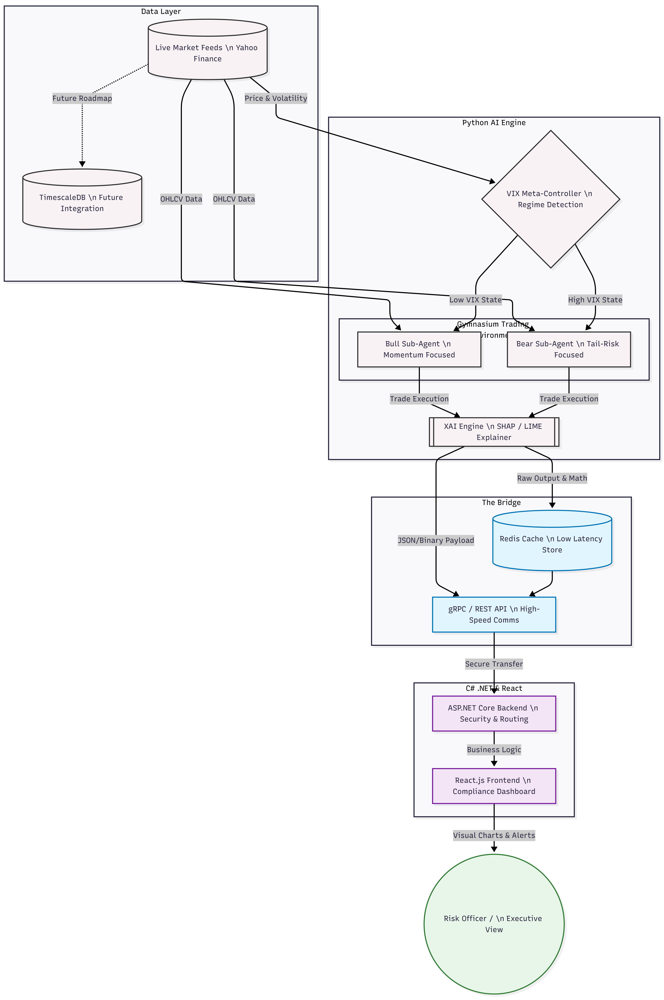

# Architecting a Regime-Aware Deep Reinforcement Learning Microservice Ecosystem for Explainable Algorithmic Trading

[](https://github.com/Devangsinh84/AI_Trading_Platform/actions/workflows/ci.yml)


---

## Overview

Modern algorithmic trading systems face a fundamental trilemma: generating consistent alpha, managing downside risk, and remaining interpretable for enterprise risk oversight. Most approaches optimise for one dimension at the cost of the others.

This project, developed for an MSc thesis in Artificial Intelligence at ECE Paris, proposes a **regime-aware microservice architecture** that treats each concern as an independent, composable service: a Deep Reinforcement Learning agent (PPO) learns trading policies, a VIX-driven regime classifier routes execution between defensive and aggressive postures, a C# Meta-Controller orchestrates the services, and SHAP explanations make each decision auditable.

## Project Status

This repository contains a **working proof-of-concept** of that architecture, not the full system.

| Component | Status |
|---|---|
| Python AI Engine: data pipeline, XGBoost baseline, PPO agent (Stable-Baselines3) | Implemented |
| Rigorous evaluation with real returns, transaction costs, Sharpe and drawdown (`v2_real_results`) | Implemented |
| SHAP explanations computed on the trained PPO policy, overall and by VIX regime (`v2_real_results`) | Implemented |
| FastAPI service → .NET Meta-Controller → React dashboard data flow | Implemented |
| Automated tests (pytest + xUnit) and CI on every push / pull request | Implemented |
| Dashboard regime label and SHAP chart | **Placeholder data** (interface demonstration) |
| VIX-driven regime routing / circuit breaker in the Meta-Controller | Planned |
| Specialised Bull/Bear sub-agents, crypto markets, LIME, Docker | Planned |

## Key Results (v2 evaluation)

S&P 500 daily data 2016-2025, chronological 80/20 split. Test period 2024-01-04 to 2025-12-30
(498 trading days), real returns, 0.1% transaction cost per trade, scaler fitted on training data only.

| Strategy | Return | Sharpe | Max drawdown |
|---|---|---|---|
| Buy & Hold | +46.94% | 1.30 | 18.90% |
| XGBoost | +27.07% | 1.00 | 14.11% |
| PPO, return-only reward (3 seeds) | -0.62% to +46.94% | -1.11 to 1.30 | 0.62% to 18.90% |
| PPO, risk-sensitive reward (3 seeds) | -6.36% to +46.94% | -0.24 to 1.30 | 12.86% to 18.90% |

**Findings.** Under realistic conditions, a single PPO agent on daily technical features did not
outperform Buy & Hold in any of seven runs; return-only agents converged to constant policies
(always invested or always in cash). A risk-sensitive reward made the agent rely on market features,
and SHAP attributions to volatility features roughly doubled on high-VIX days, but this did not
improve risk-adjusted performance in the 2024-2025 bull market. These results motivate explicit
regime routing rather than expecting one agent to discover regimes on its own.

The first prototype (`compare_strategies.py`) reported PPO +22.83% vs Buy & Hold +22.21%. That
evaluation computed returns from min-max-scaled prices and fitted the scaler before the train/test
split, so its numbers are not real-world returns. It is kept for reference; use `v2_real_results`.

Full details, figures and logs: [`Python_AI_Engine/v2_real_results/results_archive/RESULTS.md`](Python_AI_Engine/v2_real_results/results_archive/RESULTS.md)

---

## System Architecture

The platform is composed of three decoupled microservices that communicate over REST. Each service owns a single responsibility and can be developed, tested, and scaled independently.

```
┌─────────────────────────────────────────────────────────────┐
│                    React Dashboard : 5173                   │
│         XAI Charts · Portfolio Metrics · Live Feed         │
└──────────────────────────┬──────────────────────────────────┘
                           │  REST (HTTP GET/POST)
                           ▼
┌─────────────────────────────────────────────────────────────┐
│               .NET Meta-Controller API : 5200               │
│      Trade Router · Performance Metrics (proxy layer)       │
└──────────────────────────┬──────────────────────────────────┘
                           │  REST (HTTP POST /predict)
                           ▼
┌─────────────────────────────────────────────────────────────┐
│                  Python AI Engine : 8000                    │
│        PPO Agent · XGBoost Baseline · SHAP · FastAPI        │
└─────────────────────────────────────────────────────────────┘
```



The React Dashboard polls the .NET Meta-Controller for live market data and performance metrics. The Meta-Controller forwards prediction requests to the Python AI Engine and maintains an in-memory portfolio state tracker. The Python AI Engine hosts the trained PPO model and XGBoost baseline, returning predictions and (currently placeholder) SHAP feature importance payloads for the dashboard.

---

## Tech Stack

**Python AI Engine**
- Python 3.11+
- Stable-Baselines3 (PPO — Proximal Policy Optimization)
- FastAPI + Uvicorn (REST microservice host)
- pandas-ta (technical indicator generation)
- XGBoost (supervised learning baseline)
- SHAP (explainable AI, KernelExplainer on the PPO policy); LIME planned
- yfinance (live market data ingestion)
- PyTorch 2.x (neural network backend)
- Matplotlib (evaluation charting)

**DotNet MetaController**
- C# 11 / .NET 10.0
- ASP.NET Core Web API
- Scalar (OpenAPI explorer)
- In-memory portfolio state tracking
- HttpClient (Python AI Engine proxy)

**React Dashboard**
- React 19 + Vite 8
- Tailwind CSS v4
- Recharts (SHAP feature-importance panel)
- Lightweight Charts (candlestick feed)
- Lucide React (iconography)

---

## Repository Structure

```
AI_Trading_Platform/
├── Python_AI_Engine/          # Quantitative brain — data, training, XAI, FastAPI
│   ├── data/                  # Processed S&P 500 CSVs + trained XGBoost model
│   ├── models/                # Saved PPO agent + training checkpoints
│   ├── tensorboard_logs/      # PPO training telemetry
│   ├── api_gateway.py         # FastAPI entry point (XGBoost prediction endpoint)
│   ├── main.py                # FastAPI entry point for the dashboard (demo: live price + placeholder regime/SHAP)
│   ├── train_agent.py         # PPO training pipeline
│   ├── evaluate_agent.py      # Post-training evaluation on test data
│   ├── compare_strategies.py  # Buy & Hold vs XGBoost vs PPO showdown
│   ├── trading_env.py         # Custom Gymnasium trading environment
│   ├── baseline_model.py      # XGBoost baseline training
│   ├── data_fetcher.py        # Live market data + indicator computation
│   ├── data_ingestion.py      # Historical data processing pipeline
│   ├── ai_preprocessing.py    # Feature engineering
│   ├── requirements.txt
│   ├── requirements-test.txt  # Lightweight dependencies for the test suite
│   ├── tests/                 # pytest suite for the v2 pipeline
│   └── v2_real_results/       # Corrected evaluation pipeline, real SHAP, archived results
│
├── DotNet_MetaController/     # Orchestration layer: proxy + metrics API (circuit breaker planned)
│   ├── MetaController.Tests/  # xUnit tests for the metrics service and portfolio state
│   └── MetaController.API/
│       ├── Controllers/       # TradingIntelligenceController (live-feed, evaluate)
│       ├── Services/          # PerformanceMetricsService + LivePortfolioState
│       ├── Clients/           # PythonAiClient (HTTP proxy)
│       ├── Models/            # Request/response DTOs
│       └── Program.cs         # Service registration + CORS + endpoints
│
└── React_Dashboard/           # XAI presentation layer
    ├── src/
    │   ├── components/        # Dashboard, TradingChart, PerformanceMetrics
    │   ├── App.jsx
    │   └── main.jsx
    ├── vite.config.js
    └── package.json
```

---

## Getting Started

> **Prerequisites:** Python 3.11+, .NET 10 SDK, Node.js 20+

All three services must be running simultaneously. Start them in the order below.

---

### 1. Python AI Engine

The quantitative core. Hosts the trained PPO agent and XGBoost baseline via FastAPI on port `8000`.

```bash
cd Python_AI_Engine
```

Create and activate a virtual environment:

```bash
python -m venv venv

# For Windows:
.\venv\Scripts\activate

# For Mac/Linux:
source venv/bin/activate
```

Install dependencies:

```bash
pip install -r requirements.txt
```

**Option A — Run the dashboard demo server (live price feed, placeholder regime and SHAP values):**

```bash
uvicorn main:app --reload --port 8000
```

**Option B — Run the XGBoost trade routing gateway:**

```bash
python api_gateway.py
```

**Optional: Re-train the PPO agent from scratch:**

```bash
python train_agent.py
```

**Optional: Evaluate the trained agent on unseen test data:**

```bash
python evaluate_agent.py
```

**Optional: Run the three-way strategy comparison (Buy & Hold vs XGBoost vs PPO):**

```bash
python compare_strategies.py
```

The FastAPI service will be available at `http://localhost:8000`. You can verify it is online at `http://localhost:8000/` which returns a health-check JSON payload.

---

### 2. DotNet MetaController

The orchestration layer (circuit-breaker routing is planned). Proxies requests between the AI engine and the React frontend. Exposes performance metrics calculated from live price ticks.

```bash
cd DotNet_MetaController/MetaController.API
```

Restore packages and start the API:

```bash
dotnet run
```

The API will start on `http://localhost:5200`.

Key endpoints:
- `GET /api/tradingintelligence/live-feed` — proxies the live prediction from the Python AI Engine and records each price tick
- `GET /api/performance-metrics` — returns live Sharpe Ratio, Max Drawdown, and Cumulative Return calculated from in-memory price history
- `GET /scalar/v1` — Scalar OpenAPI explorer

> The Meta-Controller expects the Python AI Engine to be running on port `8000` before calling the live-feed endpoint.

---

### 3. React Dashboard

The XAI presentation layer. Displays live price data, a SHAP feature-importance panel (placeholder data in the current demo), and performance metrics computed on the live price feed.

```bash
cd React_Dashboard
```

Install dependencies:

```bash
npm install
```

Start the development server:

```bash
npm run dev
```

The dashboard will be available at `http://localhost:5173`.

> CORS is pre-configured in the Meta-Controller to allow requests from `http://localhost:5173`. No additional configuration is needed.

---

### Service Port Summary

| Service | Technology | Port |
|---|---|---|
| Python AI Engine | FastAPI / Uvicorn | `8000` |
| DotNet MetaController | ASP.NET Core | `5200` |
| React Dashboard | Vite Dev Server | `5173` |

---

## Testing & CI

Every push to `main` and every pull request runs the [CI workflow](.github/workflows/ci.yml) on GitHub Actions:

| Job | What it checks |
|---|---|
| **Python AI engine** (pytest) | Backtester and metrics (returns, transaction costs, Sharpe, drawdown), technical indicators (no look-ahead, no infinite values), and the v2 trading environment, including a check that the RL environment and the backtester compute the same portfolio value |
| **.NET Meta-Controller** (xUnit) | `PerformanceMetricsService` (cumulative return, maximum drawdown, Sharpe) and `LivePortfolioState` (returns history, defensive copies, thread safety) |
| **React dashboard** | Production build with Vite |

Run the tests locally:

```bash
# Python (from Python_AI_Engine/)
pip install -r requirements-test.txt
pytest

# .NET (from DotNet_MetaController/)
dotnet test MetaController.Tests/MetaController.Tests.csproj
```

The tests use small synthetic data, so they need no market data download and no GPU.

---

## Research Pipeline

**Recommended: the corrected v2 pipeline.** See [`Python_AI_Engine/v2_real_results/RUN_V2.md`](Python_AI_Engine/v2_real_results/RUN_V2.md):

| Step | Script | Purpose |
|---|---|---|
| 1 | `step1_prepare_data.py` | S&P 500 + VIX, stationary features, train-only scaling |
| 2 | `step2_train_ppo.py` | PPO training (`--seed`, `--risk` for the risk-sensitive reward) |
| 3 | `step3_evaluate.py` | Buy & Hold vs XGBoost vs PPO: return, Sharpe, drawdown, VIX regimes |
| 4 | `step4_shap.py` | SHAP explanations of the trained PPO policy |

**Original prototype pipeline** (kept for reference; its returns are computed on scaled prices):

| Step | Script | Purpose |
|---|---|---|
| 1 | `data_ingestion.py` | Download and process 10 years of S&P 500 data |
| 2 | `ai_preprocessing.py` | Generate technical indicators (RSI, MACD, Bollinger Bands) |
| 3 | `baseline_model.py` | Train the XGBoost supervised learning baseline |
| 4 | `train_agent.py` | Run PPO deep reinforcement learning (270,000 timesteps) |
| 5 | `evaluate_agent.py` | Evaluate PPO agent on held-out test data |
| 6 | `compare_strategies.py` | Generate the three-strategy showdown chart |

TensorBoard training logs are written to `Python_AI_Engine/tensorboard_logs/`. To visualise them:

```bash
cd Python_AI_Engine
tensorboard --logdir tensorboard_logs/
```

---

## Future Work

The foundational microservice architecture is designed for extensibility. The current system is trained and evaluated on S&P 500 index data, but the environment, data pipeline, and API contracts are asset-agnostic.

The next development phase has the following items scoped:

- **Dynamic asset switching** — a UI ticker-selection dropdown that allows the user to switch between instruments (equities, crypto, ETFs) at runtime without restarting any service
- **Live VIX regime integration** — replacing the placeholder regime signal with a real-time CBOE VIX feed to drive the circuit-breaker routing logic in the Meta-Controller
- **EU AI Act compliance report generation** — automated PDF export of SHAP/LIME explanations per trade session, formatted for regulatory submission
- **Explicit regime routing** — specialised agents per volatility regime, selected by the Meta-Controller, compared against a single monolithic PPO agent
- **Broader evaluation** — walk-forward testing over several market cycles, more assets and more seeds
- **Containerisation** — Docker Compose manifest to orchestrate all three microservices as a single deployable unit

---

## How to Cite

If you use this code or its results, please cite it. GitHub's **"Cite this repository"** button (from [`CITATION.cff`](CITATION.cff)) provides APA and BibTeX formats:

> Gohil, D. (2026). *Architecting a Regime-Aware Deep Reinforcement Learning Microservice Ecosystem for Explainable Algorithmic Trading* [Computer software]. ECE Paris. https://github.com/Devangsinh84/AI_Trading_Platform

---

## License

Distributed under the MIT License. See `LICENSE` for more information. Reuse is permitted provided the copyright notice is kept.


---

## Author & Maintainer

**Devangsinh Gohil**
* GitHub: [@Devangsinh84](https://github.com/Devangsinh84)
* LinkedIn: [https://www.linkedin.com/in/devangsinh-gohil-70a42a239/](https://www.linkedin.com/in/devangsinh-gohil-70a42a239/)
* Project Link: [https://github.com/Devangsinh84/AI_Trading_Platform](https://github.com/Devangsinh84/AI_Trading_Platform)
